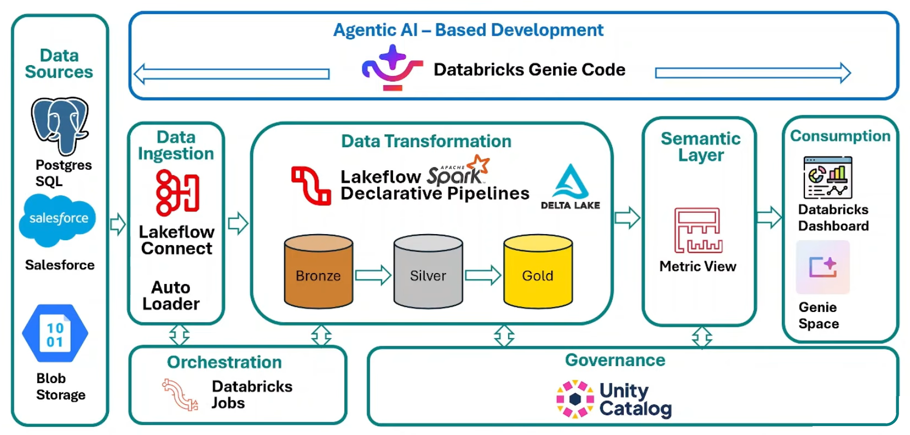
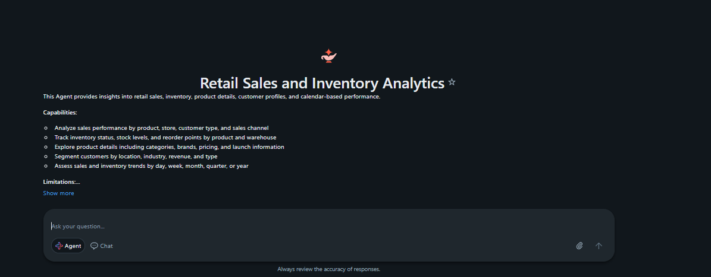
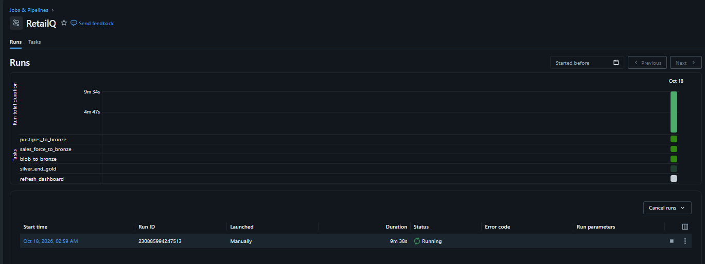
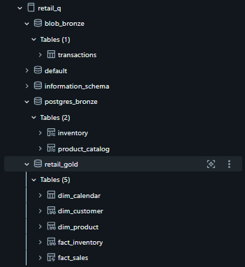

# 🛒 Retail Data Engineering Project no Databricks

Pipeline de dados de ponta a ponta para um cenário de **varejo**, construído no **Databricks** com arquitetura medalhão (**Bronze → Silver → Gold**). O projeto integra três fontes (PostgreSQL, Salesforce e Azure Blob Storage), aplica regras de qualidade com **Lakeflow Spark Declarative Pipelines**, publica um modelo dimensional governado pelo **Unity Catalog** e entrega os dados por uma **Metric View**, um **dashboard AI/BI** e um **Genie Space**, tudo orquestrado por um **Databricks Job**.

---

## 📐 Arquitetura



| Etapa | Tecnologia | O que faz |
|---|---|---|
| Fontes | PostgreSQL, Salesforce, Azure Blob Storage | Dados de estoque, catálogo de produtos, clientes, oportunidades e transações |
| Ingestão | Lakeflow Connect e Auto Loader | Carga incremental para a camada Bronze |
| Transformação | Lakeflow Spark Declarative Pipelines + Delta Lake | Limpeza, padronização e qualidade (Silver) e modelo dimensional (Gold) |
| Camada semântica | Metric View | KPIs centralizados e reutilizáveis |
| Consumo | Databricks Dashboard e Genie Space | Visualização e perguntas em linguagem natural |
| Orquestração | Databricks Jobs | Execução encadeada de todas as etapas |
| Governança | Unity Catalog | Catálogo `retail_q`, schemas por camada e controle de acesso |

---

## 🧰 Stack

`Databricks` · `PySpark` · `Spark SQL` · `Lakeflow Connect` · `Auto Loader` · `Lakeflow Spark Declarative Pipelines` · `Delta Lake` · `Unity Catalog` · `Metric Views` · `AI/BI Dashboards` · `Genie` · `Databricks Jobs` · `Azure Blob Storage` · `PostgreSQL` · `Salesforce`

---

## 🥉 Bronze: ingestão

| Fonte | Ferramenta | Destino (`retail_q`) | Tabelas |
|---|---|---|---|
| PostgreSQL | Lakeflow Connect | `postgres_bronze` | `inventory`, `product_catalog` |
| Salesforce | Lakeflow Connect | `salesforce_bronze` | `account`, `opportunity` |
| Azure Blob Storage (CSV em Volume) | Auto Loader | `blob_bronze` | `transactions` |

- **Auto Loader** ([`01_ingestion/blob_to_bronze.ipynb`](01_ingestion/blob_to_bronze.ipynb)): lê os CSVs de `/Volumes/retail_q/volumes/blob_source/transactions_source/` em streaming, com inferência de schema e checkpoint, e usa `trigger(availableNow=True)` para processar só os arquivos novos a cada execução (batch incremental).
- **Lakeflow Connect**: os conectores do PostgreSQL e do Salesforce são configurados pela interface do Databricks (sem código neste repositório). As tabelas chegam com as colunas de CDC/SCD `__START_AT` e `__END_AT`.

---

## 🥈 Silver: limpeza e qualidade

Código em [`02_silver_pipeline/bronze_to_silver/`](02_silver_pipeline/bronze_to_silver/), escrito com `pyspark.pipelines` (`@dp.table`). As tabelas ficam em `retail_q.retail_silver`.

O que acontece nesta camada:
- Padronização de nomes de colunas para `snake_case`.
- Limpeza de texto (`trim`, `upper`, `initcap`) e preenchimento de nulos (`UNKNOWN`/`Unknown`).
- **Colunas derivadas** com regras de negócio.
- **Expectations** de qualidade: `@dp.expect` registra a violação e `@dp.expect_or_drop` descarta a linha.

| Tabela | Colunas derivadas | Principais regras de qualidade |
|---|---|---|
| `account` | `is_active` (a partir de `__END_AT`) | `id` não nulo (drop), `customer_name` não nulo |
| `opportunity` | `deal_size` (`ENTERPRISE` / `MID_MARKET` / `SMALL`) | `id` não nulo (drop), `amount ≥ 0`, `probability` entre 0 e 100, `stage_name` válido |
| `product_catalog` | `product_segment` (`PREMIUM` / `MID_RANGE` / `BUDGET`), `is_active`, `processed_at` | `product_id`, `product_name` e `launch_date` obrigatórios (drop), `unit_price > 0` |
| `inventory` | `inventory_status` (`LOW_STOCK` / `HEALTHY`) | `inventory_id` não nulo (drop), `stock_quantity ≥ 0` |
| `transactions` | `gross_amount` (`quantity × selling_price`), conversão de `transaction_timestamp` | `transaction_id` não nulo (drop), `quantity > 0`, `payment_mode` válido |

---

## 🥇 Gold: modelo dimensional

Tabelas e views em `retail_q.retail_gold`, organizadas em modelo estrela:

| Objeto | Tipo | Origem |
|---|---|---|
| `fact_sales` | Tabela (pipeline) | Join de `transactions` com `opportunity`. Código em [`02_silver_pipeline/silver_to_gold/fact_sales.py`](02_silver_pipeline/silver_to_gold/fact_sales.py) |
| `dim_customer` | View | Clientes ativos e não excluídos do Salesforce |
| `dim_product` | View | Produtos ativos do catálogo |
| `fact_inventory` | View | Posição de estoque com status |
| `dim_calendar` | Tabela | Calendário gerado com `sequence()` entre `start_date` e `end_date` (ano, trimestre, mês, dia da semana, fim de semana etc.) |

Notebooks: [`03_gold/02_gold_views.ipynb`](03_gold/02_gold_views.ipynb) e [`03_gold/03_calendar.ipynb`](03_gold/03_calendar.ipynb).

---

## 📊 Camada semântica: Metric View

[`03_gold/04_Metric_view.ipynb`](03_gold/04_Metric_view.ipynb) cria a Metric View **`retail_q.retail_semantic.retail_metrics`** (definida em YAML). Ela parte de `fact_sales` e faz join com `dim_product`, `dim_calendar` e `dim_customer`.

- **Medidas:** Transaction Count, Total Revenue, Total Quantity Sold, Total Discount, Average Transaction Value, Unique Customers.
- **Dimensões:** data, ano, trimestre, mês, categoria e marca do produto, forma de pagamento, canal de venda, estágio da oportunidade, tipo/nome do cliente, cidade, estado, país e indústria.
- Cada medida e dimensão tem `display_name`, `comment`, formato e **sinônimos**, o que melhora as respostas do Genie.

```sql
SELECT `Product Category`, `Year`,
       MEASURE(`Total Revenue`),
       MEASURE(`Total Quantity Sold`)
FROM retail_q.retail_semantic.retail_metrics
GROUP BY ALL
ORDER BY MEASURE(`Total Revenue`) DESC;
```

---

## 📈 Consumo

- **Databricks Dashboard:** [`04_dashboard/Retail Analytics Dashboard.lvdash.json`](04_dashboard/Retail%20Analytics%20Dashboard.lvdash.json). Para usar, importe o arquivo em *Dashboards → Import*.
- **Genie Space "Retail Sales and Inventory Analytics":** agente para perguntas em linguagem natural sobre vendas, estoque, produtos, clientes e calendário.



---

## ⚙️ Orquestração

O job **`RetailQ`** executa o fluxo completo:

`postgres_to_bronze` → `sales_force_to_bronze` → `blob_to_bronze` → `silver_end_gold` → `refresh_dashboard`



---

## 🗂️ Tabelas no Unity Catalog



---

## 📁 Estrutura do repositório

```
Retail-Data-Engineering-Project-in-Databricks/
├── 01_ingestion/
│   └── blob_to_bronze.ipynb          # Auto Loader: Blob (CSV) → Bronze
├── 02_silver_pipeline/               # Lakeflow Spark Declarative Pipeline
│   ├── bronze_to_silver/
│   │   ├── account.py
│   │   ├── inventory.py
│   │   ├── opportunity.py
│   │   ├── product_catalog.py
│   │   └── transactions.py
│   └── silver_to_gold/
│       └── fact_sales.py
├── 03_gold/
│   ├── 02_gold_views.ipynb           # dim_customer, dim_product, fact_inventory
│   ├── 03_calendar.ipynb             # dimensão calendário
│   └── 04_Metric_view.ipynb          # camada semântica
├── 04_dashboard/
│   └── Retail Analytics Dashboard.lvdash.json
├── docs/                             # imagens do README
└── README.md
```

---

## ▶️ Como reproduzir

1. **Unity Catalog:** crie o catálogo `retail_q`, os schemas (`blob_bronze`, `postgres_bronze`, `salesforce_bronze`, `retail_silver`, `retail_gold`, `retail_semantic`) e o Volume `retail_q.volumes.blob_source`.
2. **Ingestão:** configure os conectores do **Lakeflow Connect** para PostgreSQL e Salesforce. Envie os CSVs de transações para o Volume e rode `01_ingestion/blob_to_bronze.ipynb`.
3. **Pipeline:** crie um *Lakeflow Spark Declarative Pipeline* apontando para a pasta `02_silver_pipeline/`.
4. **Gold:** rode `03_gold/02_gold_views.ipynb` e `03_gold/03_calendar.ipynb`, informando os parâmetros `start_date` e `end_date`.
5. **Camada semântica:** rode `03_gold/04_Metric_view.ipynb`.
6. **Consumo:** importe o dashboard de `04_dashboard/` e crie um Genie Space sobre as tabelas Gold e a Metric View.
7. **Orquestração:** crie um Job encadeando as etapas acima.

---

## 🙏 Créditos

Projeto desenvolvido acompanhando o curso da **DataBeli** no YouTube: [assista ao vídeo](https://www.youtube.com/watch?v=QHwszePV3GY&t=4133s).

---

## 👤 Autor

**Gabriel Thiago Da Silva**: [GitHub @Gabrielxdev](https://github.com/Gabrielxdev)
